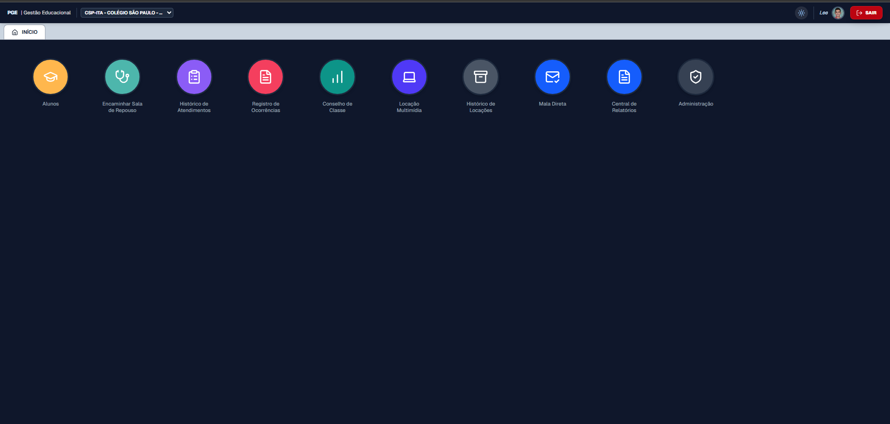
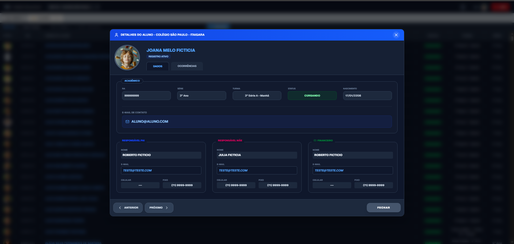
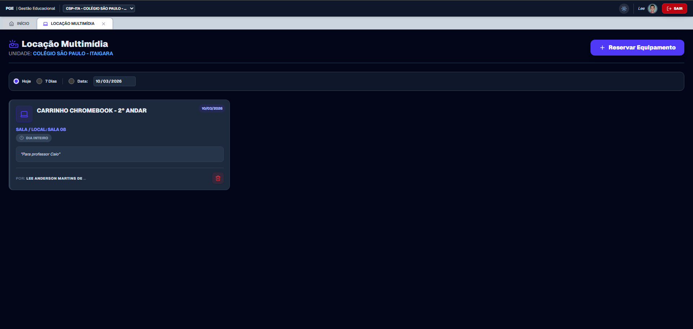
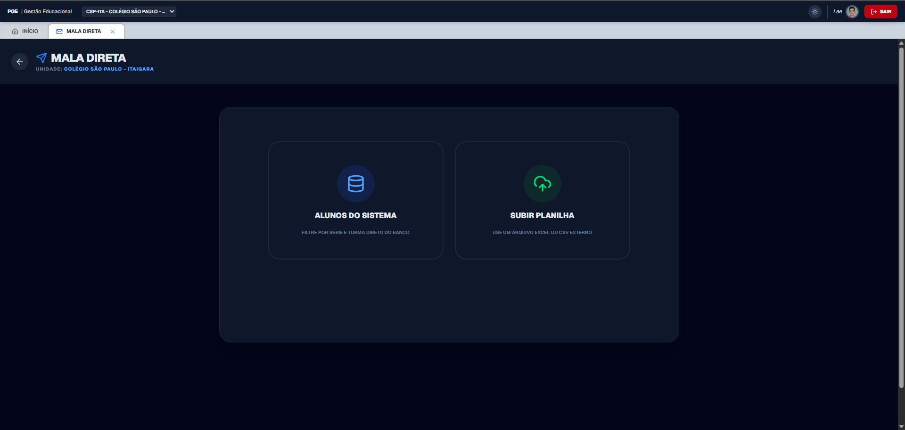

<div align="center">
  
  <h1>Portal de Gestão Escolar (PGE) 🎓</h1>
  <p><em>Plataforma web Multi-Tenant para gestão acadêmica, hospitalar, disciplinar e logística de instituições de ensino.</em></p>

  <p>
    
    
    
    
    
    
    
    
    
  </p>
</div>

---

## 📖 Visão Geral

O **PGE** foi idealizado para centralizar, modernizar e blindar as operações diárias de um ecossistema educacional de grande porte. A aplicação interliga o acompanhamento acadêmico, fluxos hospitalares de enfermaria, reservas de infraestrutura, além do disparo de comunicações externas apoiado nativamente por **Inteligência Artificial**.

Construído sob uma lógica **Multi-Tenant**, o PGE atende com folga inúmeras sedes (unidades físicas) numa única instância. Essa engenharia é somada agora a um gerenciamento de Cache de Última Geração (Stale-While-Revalidate), entregando não somente segurança (via RLS), mas uma interação instantânea e livre de travamentos (*zero-loading lock*).

---

## 📸 Showcase da Interface

> *A interface foi desenhada com foco em UX, responsividade e acessibilidade, contando com suporte nativo a **Dark Mode**.*

| Dashboard Principal | Detalhes do Aluno (Dark Mode) |
| :---: | :---: |
|  |  |
| **Locação Multimídia (Smart Booking)** | **Relatórios & Mala Direta com IA** |
|  |  |

---

## 🚀 Principais Funcionalidades e Módulos

### 🏢 Arquitetura Multi-Tenant & Acessos
- **Seletor de Unidades:** Os usuários transitam entre diferentes sedes (ex: Pituba, Itaigara) com um clique, reidratando todo o contexto da aplicação em tempo real.
- **SSO Institucional:** Autenticação via Google OAuth2, restrita a domínios autorizados (ex: `@cspba.com.br`).
- **Painel de Administração Modular:** Controle granular de acesso por colaborador (Admin vs User), gestão de unidades escolares independentes e **rastreabilidade total via Logs de Auditoria** de todas as ações críticas.

### 🎓 Gestão de Alunos (Detalhes 360º)
- Busca unificada ultrarrápida.
- **Modal de Detalhes:** Visualização consolidada de dados acadêmicos, contatos dos responsáveis e foto com recurso de zoom in/out.
- Linha do tempo centralizada unindo o histórico disciplinar e médico do aluno.

### ✨ Mala Direta Inteligente (Powered by Google Gemini)
- **Assistente de Redação (IA):** Integração nativa com a API do Google Gemini. Os usuários podem solicitar à IA para criar, reescrever ou formatar convites, avisos e comunicados com um único clique.
- **Integração Rica:** A IA injeta os textos gerados, em formato HTML limpo, diretamente no editor WYSIWYG (React-Quill-New).
- **Processamento de Lote:** Importação de destinatários do banco de dados ou planilhas externas com disparo via Nodemailer.
- **Motor de Tags Dinâmicas:** Uso de `{{Nome}}`, `{{Turma}}` para personalização em massa.

### 🩺 Sala de Repouso (Enfermaria)
- Fluxo de trabalho em tempo real: Educadores encaminham alunos detalhando sintomas.
- Fila de espera visível para a equipe de enfermagem.
- Registro de triagem, observações de atendimento e liberação (Sala/Casa).
- Exportação automatizada de laudos e estatísticas para Excel (`.csv` e `.xlsx`).

### ⚖️ Conselho de Classe Inteligente
- Motor de importação massiva de planilhas (`xlsx`/`csv`).
- Filtros dinâmicos que identificam alunos em recuperação cruzando notas de Exame Final e Etapas contra uma **Média de Corte** parametrizável.
- Destaque visual (UI/UX) automático para notas abaixo da média.

### 📽️ Locação Multimídia (Smart Booking)
- Gestão de inventário de equipamentos por sede.
- Algoritmo de prevenção de conflitos: Bloqueia locações caso o equipamento não tenha quantidade disponível no horário/data solicitados.
- Visão gerencial de histórico e auditoria (quem solicitou, horário e destino).

### 🖨️ Central de Relatórios (Pixel-Perfect)
- Geração de "Históricos Escolares" (Frente e Verso) complexos.
- Filtros Avançados Agnósticos a Acentos e Case-Insensitive (para garantir localização precisa independente da digitação humana).
- Otimização de Paginação de Alta Carga: Algoritmo de "Range Indexing" que ignora nativamente as travas do Supabase e permite listar escolas com mais de 3000 alunos simultâneos (Módulo de Fichas).
- Motor de impressão injetado via CSS (`@media print`) garantindo fidelidade absoluta de dimensões (A4), margens e quebras de página em relação aos documentos oficiais do MEC/SEC.

### 🎲 Sorteio Pro
- Motor estatístico seguro e inteligente suportado pelo Google Gemini para randomização controlada (listas justas e sem colisão).

---

## 🛠️ Stack Tecnológico

**Frontend:**
- [Next.js 15.1](https://nextjs.org/) (App Router, Server & Client Components)
- [React 19](https://react.dev/)
- [Tailwind CSS v4](https://tailwindcss.com/) (Estilização avançada com `@custom-variant dark`)
- **SWR (Stale-While-Revalidate)** (Gerenciamento de cache e estado modular de altíssima performance)
- **React-Loading-Skeleton** (Loaders autônomos para redução de *Time-to-Interactive*)
- **next-themes** (Gestão fluida de Dark/Light mode sem FOUC)
- **Lucide React** (Iconografia)
- **SweetAlert2** (Feedback visual avançado)
- **React-Quill-New** (Editor WYSIWYG)

**Qualidade de Código, CI/CD e Testes (QA):**
- **GitHub Actions** (Pipeline descentralizado rodando Linter, Validação TypeScript e Suíte de Testes (E2E/Unitários) antes de cada Deploy)
- [Jest](https://jestjs.io/) & **React Testing Library** (Módulo para estabilidade Unitária e Test-Driven Development isolado em UI/Frontend)
- [Playwright](https://playwright.dev/) (Módulo de End-to-End capaz de simular navegadores fantasmas rastreando toda interatividade lógica do Usuário via SSO e Rotas Privadas)

**Backend & Integrações:**
- [Supabase](https://supabase.com/) (BaaS)
- **Google Generative AI SDK** (Integração com Gemini 2.5 Flash)
- **Next.js API Routes** (Edge Functions para processamento de e-mails, exclusão segura de usuários e IA)
- **Nodemailer** (Serviço SMTP de disparos)
- **PapaParse & XLSX** (Processamento em memória de planilhas)

**Hospedagem:**
- [Netlify](https://www.netlify.com/) (CI/CD Automatizado com cache tuning via `netlify.toml`)

---

## 🔒 Segurança e Banco de Dados (PostgreSQL)

Um dos maiores diferenciais deste projeto é a arquitetura de segurança de dados implementada no backend:

1. **Row Level Security (RLS):** Todas as tabelas críticas possuem políticas RLS estritas no Postgres. Um usuário só pode inserir, editar ou deletar registros se estiver autenticado e, em operações destrutivas, se for o autor da ação ou um Administrador validado pela tabela `permissoes_usuarios`.
2. **Database Triggers:** Sincronização automática (`AFTER INSERT`) entre o Identity Provider do Supabase (`auth.users`) e a tabela pública de colaboradores.
3. **Secure Views:** Uso de Views com `security_invoker = on` para cruzar dados sensíveis de usuários com matrizes de permissões sem expor a camada de autenticação ao Client-Side.
4. **Proteção da Chave da IA:** As requisições ao Gemini são processadas exclusivamente Server-Side (via API Routes) para evitar a exposição da `GEMINI_API_KEY` ao navegador do usuário.
5. **Cookies Seguros:** Middleware interceptador e rotas de callback que forçam o armazenamento de tokens com flags `sameSite: "lax"` e `secure: true`.
6. **Trilha de Auditoria (Audit Trail):** Sistema de logs blindado no banco de dados. Qualquer alteração de acessos, exclusão de registros ou importação em massa é gravada com carimbo de tempo e identificação do usuário. As políticas de RLS impedem até mesmo administradores de apagar ou adulterar este histórico.

---

## 📁 Estrutura de Diretórios (Resumo)

```text
.github/
└── workflows/
    └── ci.yml                    # Definições das Rotinas de Automação de Cibersegurança + Testes (Actions)
src/
├── app/
│   ├── api/
│   │   ├── gemini/               # Rota segura Server-Side para IA
│   │   ├── mala-direta/          # Rota de Node para SMTP/Disparos
│   │   └── usuarios/             # Rota segura Server-Side para exclusão de contas
│   ├── auth/callback/            # Fluxo OAuth2 Seguro
│   ├── dashboard/                # Rotas Protegidas do Sistema
│   │   ├── admin/                # Painel Administrativo Modularizado
│   │   │   ├── GestaoEquipamentos.tsx # CRUD de Inventário e Dispositivos
│   │   │   ├── GestaoSedes.tsx        # Gestão de Unidades (Multi-Tenant)
│   │   │   ├── GestaoUsuarios.tsx     # Controle Granular de Permissões
│   │   │   ├── LogsAuditoria.tsx      # Rastreabilidade e Segurança de Eventos
│   │   │   ├── SincronizacaoBase.tsx  # Importador de Planilhas (CSV)
│   │   │   └── page.tsx               # Interface (Menu Lateral) do Painel
│   │   ├── alunos/               # Grid, Busca e Modais (Prontuário/Ocorrência)
│   │   ├── conselho/             # Parse de Notas e Regras Acadêmicas
│   │   ├── locacoes/             # Smart Booking
│   │   ├── mala-direta/          # Editor Rich Text + IA Assistente
│   │   ├── relatorios/           # Motor de Impressão A4 (Pixel-Perfect)
│   │   └── repouso/              # Fluxo de Enfermaria Hospitalar
│   ├── layout.tsx                # Tema (Dark Mode) e Provedores Root
│   └── page.tsx                  # Interface de Login (Google SSO)
├── components/
│   ├── layout/                   # Header, Seletor de Unidades, Tabs
│   └── ThemeProvider.tsx         # Motor Next-Themes
├── context/
│   ├── AuthContext.tsx           # Gestão de Sessão do Usuário
│   └── ColigadaContext.tsx       # Controle de Estado das Sedes
└── lib/
    ├── audit.ts                  # Função Global "Espiã" de Logs de Auditoria
    └── supabase.ts               # Instância do Banco de Dados (BaaS)

ARCHITECTURE.md                   # Log Mestre com decisões de Arquitetura do Software
```

---

## 🧪 Testes Automatizados (Quality Assurance)

O desenvolvimento contínuo (CD) do portal é blindado por uma suíte completa de testes. Certifique a vitalidade de atualizações rodando os scripts pelo seu terminal a qualquer momento:

- `npm run test` : Analisa e corre todos os casos de Testes Unitários de maneira ultrarrápida (útil para validar matemática nos KPIs da Dashboard).
- `npm run test:watch` : Abre uma sessão de verificação ativa no Terminal e testa os arquivos sempre que o desenvolvedor comandar um "CRTL + S" (modo Watcher).
- `npm run e2e` : Ativa o ecossistema Web e delega o trajeto principal ao *Playwright* - Um fantasma virtual (Chromium) que acessa, testa fluxos de rotas protegidas verificando a resiliência estrutural. Tira radiografia (DOM) da raiz do site até a rota e acusa imediatamente em caso de Tela em Branco.

---

## ⚙️ Passo a Passo para Implantação (Deployment)

### 1. Configuração do Backend (Supabase)

Crie um projeto no [Supabase](https://supabase.com/) e execute os scripts abaixo na aba **SQL Editor** na seguinte ordem:

#### A. Estrutura Base (Tabelas)

```sql
CREATE TABLE public.sedes (
  id integer NOT NULL PRIMARY KEY,
  nome text NOT NULL,
  sigla text NOT NULL,
  created_at timestamp with time zone DEFAULT timezone('utc'::text, now())
);

CREATE TABLE public.alunos (
  id bigint NOT NULL PRIMARY KEY,
  nome text NOT NULL,
  serie text,
  turma text,
  status text,
  nascimento text,
  email text,
  pai text,
  celular_pai text,
  fixo_pai text,
  mae text,
  celular_mae text,
  fixo_mae text,
  Anosemestre text,
  Curso text,
  "Nome curso" text,
  c_turma text,
  Turno text,
  email_pai text,
  email_mae text,
  financeiro_nome text,
  financeiro_email text,
  financeiro_celular text,
  financeiro_fixo text,
  sede_id integer DEFAULT 1219 REFERENCES public.sedes(id),
  importado_em timestamp with time zone DEFAULT now()
);

CREATE TABLE public.usuarios (
  id uuid NOT NULL PRIMARY KEY REFERENCES auth.users(id) ON DELETE CASCADE,
  email text NOT NULL,
  nome text NOT NULL,
  created_at timestamp with time zone NOT NULL DEFAULT timezone('utc'::text, now())
);

CREATE TABLE public.permissoes_usuarios (
  id uuid NOT NULL DEFAULT gen_random_uuid() PRIMARY KEY,
  user_id uuid UNIQUE REFERENCES auth.users(id),
  is_admin boolean DEFAULT false,
  sedes_permitidas ARRAY DEFAULT '{}'::integer[],
  modulos_permitidos ARRAY DEFAULT '{}'::text[],
  created_at timestamp with time zone DEFAULT timezone('utc'::text, now())
);

CREATE TABLE public.equipamentos (
  id uuid NOT NULL DEFAULT gen_random_uuid() PRIMARY KEY,
  nome text NOT NULL,
  quantidade_total integer NOT NULL DEFAULT 1,
  created_at timestamp with time zone NOT NULL DEFAULT timezone('utc'::text, now())
);

CREATE TABLE public.locacoes (
  id uuid NOT NULL DEFAULT gen_random_uuid() PRIMARY KEY,
  equipamento_id uuid REFERENCES public.equipamentos(id) ON DELETE CASCADE,
  sala text NOT NULL,
  data_locacao date NOT NULL,
  observacao text NOT NULL,
  solicitante text NOT NULL,
  created_at timestamp with time zone NOT NULL DEFAULT timezone('utc'::text, now()),
  user_id uuid REFERENCES auth.users(id),
  dia_inteiro boolean DEFAULT true,
  hora_inicio text,
  hora_fim text
);

CREATE TABLE public.ocorrencias (
  id uuid NOT NULL DEFAULT gen_random_uuid() PRIMARY KEY,
  aluno_id bigint REFERENCES public.alunos(id),
  colaborador_nome text NOT NULL,
  colaborador_id text,
  texto text NOT NULL,
  data timestamp with time zone DEFAULT timezone('utc'::text, now()),
  sede_id integer DEFAULT 1219 REFERENCES public.sedes(id)
);

CREATE TABLE public.encaminhamentos_repouso (
  id uuid NOT NULL DEFAULT gen_random_uuid() PRIMARY KEY,
  aluno_id bigint REFERENCES public.alunos(id),
  sintoma text NOT NULL,
  encaminhado_por text NOT NULL,
  hora_encaminhamento text NOT NULL,
  status text DEFAULT 'aguardando'::text,
  obs_atendimento text,
  destino text,
  atendido_por text,
  hora_atendimento timestamp with time zone,
  created_at timestamp with time zone NOT NULL DEFAULT timezone('utc'::text, now()),
  sede_id integer DEFAULT 1219 REFERENCES public.sedes(id)
);

CREATE TABLE public.conselho_notas (
  id uuid NOT NULL DEFAULT gen_random_uuid() PRIMARY KEY,
  cd_aluno text NOT NULL,
  nm_pessoa text NOT NULL,
  foto_url text,
  full_foto_url text,
  turma text,
  grades jsonb NOT NULL,
  created_at timestamp with time zone NOT NULL DEFAULT timezone('utc'::text, now()),
  sede_id integer DEFAULT 1219 REFERENCES public.sedes(id)
);

-- Tabela para a Trilha de Auditoria (Logs)
CREATE TABLE public.logs_auditoria (
  id uuid NOT NULL DEFAULT gen_random_uuid() PRIMARY KEY,
  usuario_nome text NOT NULL,
  acao text NOT NULL,
  detalhes text,
  created_at timestamp with time zone DEFAULT timezone('utc'::text, now())
);
```

#### B. Triggers e Functions (Sincronização Segura)

Execute o comando abaixo para criar o gatilho que copia os dados dos usuários do Google automaticamente, evitando a exposição da tabela sensível `auth.users` ao Frontend.

```sql
CREATE OR REPLACE FUNCTION public.copiar_dados_novo_usuario()
RETURNS trigger
SET search_path = public
AS $$
BEGIN
  INSERT INTO public.usuarios (id, email, nome)
  VALUES (
    NEW.id,
    NEW.email,
    COALESCE(NEW.raw_user_meta_data->>'full_name', NEW.raw_user_meta_data->>'name', 'Usuário')
  );
  RETURN NEW;
END;
$$ LANGUAGE plpgsql SECURITY DEFINER;

CREATE TRIGGER trigger_copiar_usuario
AFTER INSERT ON auth.users
FOR EACH ROW
EXECUTE FUNCTION public.copiar_dados_novo_usuario();
```

#### C. View Segura e Políticas RLS (Row Level Security)

Habilite as permissões dinâmicas do Painel Administrativo de forma blindada:

```sql
-- Cria a view que une o Usuário com suas Permissões
CREATE OR REPLACE VIEW public.vw_gestao_usuarios WITH (security_invoker = on) AS
SELECT
  u.id,
  u.id as user_id,
  u.email,
  u.nome,
  COALESCE(p.is_admin, false) as is_admin,
  COALESCE(p.sedes_permitidas, '{}'::integer[]) as sedes_permitidas,
  COALESCE(p.modulos_permitidos, '{}'::text[]) as modulos_permitidos
FROM public.usuarios u
LEFT JOIN public.permissoes_usuarios p ON u.id = p.user_id;

-- Habilita a Segurança em Nível de Linha (RLS)
ALTER TABLE public.ocorrencias ENABLE ROW LEVEL SECURITY;
ALTER TABLE public.locacoes ENABLE ROW LEVEL SECURITY;
ALTER TABLE public.equipamentos ENABLE ROW LEVEL SECURITY;

-- Políticas de Locações e Equipamentos
CREATE POLICY "Leitura geral equipamentos" ON public.equipamentos FOR SELECT USING (auth.role() = 'authenticated');
CREATE POLICY "Gestao equipamentos" ON public.equipamentos FOR ALL USING (auth.role() = 'authenticated');

CREATE POLICY "Leitura geral locacoes" ON public.locacoes FOR SELECT USING (auth.role() = 'authenticated');
CREATE POLICY "Inserir locacoes" ON public.locacoes FOR INSERT WITH CHECK (auth.role() = 'authenticated');
CREATE POLICY "Deletar locacoes" ON public.locacoes FOR DELETE USING (
  auth.uid() = user_id OR
  (SELECT is_admin FROM public.permissoes_usuarios WHERE user_id = auth.uid()) = true
);

-- Políticas Blindadas para Logs de Auditoria
ALTER TABLE public.logs_auditoria ENABLE ROW LEVEL SECURITY;

CREATE POLICY "Leitura de logs" ON public.logs_auditoria 
FOR SELECT USING (
  (SELECT is_admin FROM public.permissoes_usuarios WHERE user_id = auth.uid()) = true
);

CREATE POLICY "Inserir logs" ON public.logs_auditoria 
FOR INSERT WITH CHECK (
  auth.role() = 'authenticated'
);
```

---

### 2. Configuração Local (VS Code)

1. Clone o repositório:
   ```bash
   git clone [https://github.com/SEU_USUARIO/PGE.git](https://github.com/SEU_USUARIO/PGE.git)
   cd PGE
   ```
2. Instale as dependências:
   ```bash
   npm install
   ```
3. Crie um arquivo `.env.local` na raiz do projeto e insira as chaves fornecidas no painel do seu Supabase, SMTP e Gemini:
   ```env
   NEXT_PUBLIC_SUPABASE_URL=sua_url_supabase
   NEXT_PUBLIC_SUPABASE_ANON_KEY=sua_chave_anon_supabase
   SUPABASE_SERVICE_ROLE_KEY=sua_chave_secreta_de_service_role
   EMAIL_USER=seu_email_smtp_aqui
   EMAIL_PASS=sua_senha_de_aplicativo_aqui
   GEMINI_API_KEY=sua_chave_de_api_do_google_ai_studio
   ```
4. Inicie o servidor de desenvolvimento:
   ```bash
   npm run dev
   ```

---

### 3. Deploy na Netlify 🌐 (Passo a Passo Detalhado)

O projeto possui um arquivo `netlify.toml` na raiz, o que automatiza grande parte das configurações de ambiente para o Next.js.

**Passo 1:** Faça login na [Netlify](https://www.netlify.com/) utilizando sua conta do GitHub.
**Passo 2:** No painel principal, clique no botão **"Add new site"** e depois em **"Import an existing project"**.
**Passo 3:** Escolha o **GitHub** como provedor e selecione o repositório `PGE`.
**Passo 4:** Na tela de configurações de Build, a Netlify detectará automaticamente o Next.js. Confirme se os campos estão assim:

- **Framework:** Next.js
- **Build command:** `npm run build`
- **Publish directory:** `.next`

**Passo 5:** Clique no botão **"Add environment variables"** (Adicionar variáveis de ambiente). 

> [!IMPORTANT]
> É **estritamente obrigatório** inserir as chaves abaixo para o sistema em produção funcionar:
> - `NEXT_PUBLIC_SUPABASE_URL` 
> - `NEXT_PUBLIC_SUPABASE_ANON_KEY`
> - `SUPABASE_SERVICE_ROLE_KEY` (Para a IA e ações Auth Admin Server-Side)
> - `EMAIL_USER` (E-mail SMTP do Nodemailer)
> - `EMAIL_PASS` (Senha de Aplicativo SMTP)
> - `GEMINI_API_KEY` (Sua chave do Google AI Studio)

**Passo 6:** Clique em **"Deploy site"**.

> [!TIP]
> A Netlify fornecerá uma URL provisória como `nome-aleatorio.netlify.app`. Acesse "Site configuration" > "Domain management" no Dashboard e modifique para um endereço limpo como `pge-suaescola.netlify.app`.

---

<div align="center">
  <p>Desenvolvido com dedicação, arquitetura limpa e foco em performance operacional por</p>
  <h3><strong>Lee Anderson Martins de Jesus Brasil</strong></h3>
  <p>Analista de Infraestrutura / Desenvolvedor Full-Stack</p>
</div>